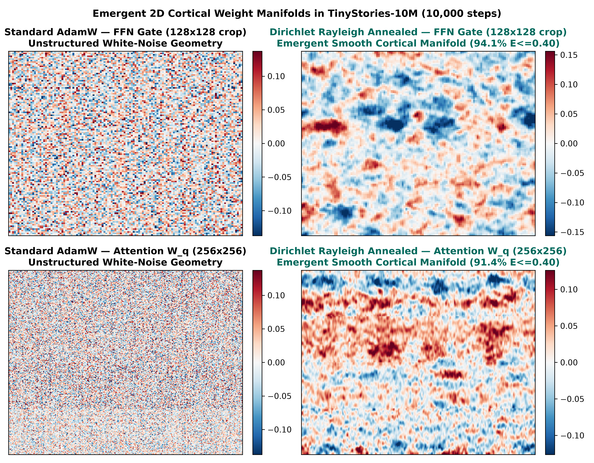

<div align="center">

# Dirichlet Regularization (`dreg`)
### Spatial Smoothness in Neural Weight Manifolds for 2D-DCT Spectral Compression

[](https://www.python.org/downloads/)
[](https://pytorch.org/)
[](https://github.com/mcarbonell/dirichlet-regularization/actions/workflows/ci.yml)
[](https://github.com/mcarbonell/dirichlet-regularization/tree/main/tests)
[](https://github.com/mcarbonell/dirichlet-regularization/tree/main/tests)
[](https://github.com/astral-sh/ruff)
[](https://github.com/mcarbonell/dirichlet-regularization/blob/main/paper/paper-draft.pdf)
[](https://github.com/mcarbonell/dirichlet-regularization/blob/main/LICENSE)

</div>

---

## The Core Idea

Standard neural networks treat weight matrices as unstructured, permutation-invariant point clouds. After training with isotropic $L_2$ weight decay, their 2D spatial frequency spectrum resembles **flat white noise** — variance is spread uniformly across all frequencies, making frequency-domain compression ineffective.

**Dirichlet Regularization (`dreg`)** introduces a simple inductive bias during training: *neighboring entries on a 2D weight lattice should vary smoothly*, analogous to topographic organization in biological cortex.

Penalizing discrete 2D spatial differences breaks permutation symmetry and **concentrates spectral energy in the low-frequency harmonics of the orthonormal 2D-DCT** — up to **~72%** of Frobenius energy below $\rho \le 0.40$ on square Attention projections (`256×256`) and **52.8%** on MNIST MLPs — enabling hierarchical Base-3 Trit spectral quantization (`.tritq`) across a configurable `0.43–3.77 bpp` rate–distortion frontier.

<p align="center">
  
</p>

> **Figure 1: Illustrative Spatial Weight Structures (MNIST MLP, 64×64 top-left patches).** 3-epoch MNIST MLP (`fc1` top, `fc2` bottom, unnormalized $\epsilon = 2 \times 10^{-3}$). Left: Standard AdamW yields high-frequency unstructured weights (edge-normalized $E_D = 0.0016$ on `fc1`). Right: 2D Dirichlet regularization induces smooth spatial manifolds ($E_D = 0.0001$, $-94\%$ roughness). On full TinyStories-10M Transformers (Table 2 of the preprint), mean $E_D$ drops by **$-72.1\%$** ($0.0123 \to 0.0034$ `numel`; $0.0062 \to 0.0017$ `edges`).

---

## The Mathematics

Standard $L_2$ weight decay penalizes **magnitude** and is strictly invariant to row/column permutations:

$$\mathcal{L}_{L_2}(W) = \frac{\gamma}{2} \|W\|_F^2$$

**Dirichlet Regularization** penalizes **2D discrete spatial differences** across the $M \times N$ weight lattice via the separable Neumann graph Laplacians $L_M \in \mathbb{R}^{M \times M}$ and $L_N \in \mathbb{R}^{N \times N}$:

$$\mathcal{E}_D^{\text{var}}(W) = \frac{1}{2MN}\!\left(\sum_{i=1}^{M-1}\sum_{j=1}^N (W_{i+1,j}-W_{i,j})^2 + \sum_{i=1}^M\sum_{j=1}^{N-1} (W_{i,j+1}-W_{i,j})^2\right) = \frac{1}{2MN}\Big(\operatorname{Tr}(W^\top L_M W) + \operatorname{Tr}(W L_N W^\top)\Big)$$

Because the eigenvectors of the 1D Neumann path-graph Laplacian are exactly the orthonormal **Type-II DCT** basis vectors, $\mathcal{E}_D$ diagonalizes in the 2D-DCT domain $S = D_M W D_N^\top$ (`numel` convention $= 2\,\mathcal{E}_D^{\text{var}}$):

$$\mathcal{E}_D^{\text{numel}}(W) = \frac{1}{MN} \sum_{k=0}^{M-1}\sum_{l=0}^{N-1} 4\!\left[\sin^2\!\left(\frac{\pi k}{2M}\right) + \sin^2\!\left(\frac{\pi l}{2N}\right)\right] S_{k,l}^2$$

High-frequency modes $(k, l)$ are penalized quadratically, concentrating weight energy into the lowest 2D-DCT harmonics.

> **Normalization note:** `dreg` provides `normalization="numel"` ($\frac{1}{MN}\sum \Delta^2 = 2\,\mathcal{E}_D^{\text{var}}$, default), `normalization="edges"` ($\approx \mathcal{E}_D^{\text{var}}$), and scale-invariant `normalization="rayleigh"` ($\frac{\sum \Delta^2}{2\|W\|_F^2} \in [0, 4]$, immune to $L_2$ magnitude shrinkage), plus `layer_weighting="param_weighted"` to balance gradient strength equally across square Attention and wide FFN layers. See [dreg/topology.py](https://github.com/mcarbonell/dirichlet-regularization/blob/main/dreg/topology.py) and §3.1 of the preprint.

<p align="center">
  
</p>

> **Figure 2: 2D-DCT Cumulative Spectral Energy (TinyStories-10M, Layer 3).** Cumulative Frobenius energy vs. normalized radius $\rho \in [0, \sqrt{2}]$. Standard AdamW stays flat ($\sim 13\text{--}14\%$ below $\rho = 0.40$). Dirichlet regularization concentrates **~72%** of energy below $\rho = 0.40$ in Attention $W_q$ (`256×256`), and **~25%** in the $4\times$ larger FFN gate projection (`256×1024`) due to $1/(MN)$ per-weight gradient scaling.

---

## Quick Start

### Installation

```bash
pip install dirichlet-regularization
```

Or from source:
```bash
git clone https://github.com/mcarbonell/dirichlet-regularization.git
cd dirichlet-regularization
pip install -e .
```

Optional extras:
```bash
pip install -e ".[examples]"    # torchvision + matplotlib for examples
pip install -e ".[dev]"         # pytest, pytest-cov, ruff
```

### Apply to Any PyTorch Model (2 lines of code)

#### Option A: Universal loss wrapper (zero model modifications)
```python
from dreg import DirichletLoss

# Automatically skips nn.Embedding, lm_head, frozen weights, and deduplicates tied weights.
# Use normalization="rayleigh" + layer_weighting="param_weighted" for scale-invariant,
# FFN-balanced smoothing (recommended: weight_decay=0.25–0.50), or classic normalization="numel"
# with weight_decay=15.0–30.0.
topo_reg = DirichletLoss(
    weight_decay=0.50,
    normalization="rayleigh",
    layer_weighting="param_weighted",
)

# Inside your training loop:
task_loss = criterion(model(inputs), targets)
total_loss = task_loss + topo_reg(model)
total_loss.backward()
```

#### Option B: Drop-in replacement for `nn.Linear`
```python
import torch.nn as nn
from dreg import TopographicLinear

class MyModel(nn.Module):
    def __init__(self):
        super().__init__()
        self.fc1 = TopographicLinear(512, 2048)
        self.fc2 = TopographicLinear(2048, 10)
        self.act = nn.GELU()

    def forward(self, x):
        return self.fc2(self.act(self.fc1(x)))

    def dirichlet_loss(self):
        return 0.5 * (self.fc1.dirichlet_energy() + self.fc2.dirichlet_energy())

model = MyModel()
loss = criterion(model(x), y) + 15.0 * model.dirichlet_loss()
loss.backward()
```

> **Calibration tip:** Because `dirichlet_energy_2d` is normalized by $MN$, raw values are $\sim 10^{-3}\text{--}10^{-2}$. Use $\lambda_{\text{topo}} \in [5.0, 30.0]$ (rather than `0.01`, which is washed out by AdamW).

---

## Empirical Highlights

### 1. TinyStories 10.56M Transformer (81.92M tokens, A10G GPU)

Evaluated on 25 validation batches (204,800 tokens; full results in [results/pareto_curve_tinystories_results.json](https://github.com/mcarbonell/dirichlet-regularization/blob/main/results/pareto_curve_tinystories_results.json) and Preprint Table 5):

| Quantization Regime | Radii $(r_0, r_1, r_2)$ | Linear Rate | Compression | Std PPL | Topo PPL ($\lambda=30$) | Dirichlet Gain |
| :--- | :---: | :---: | :---: | :---: | :---: | :---: |
| Dense FP32 (Reference) | — | 32.000 bpp | 1.0× | **6.11** | 6.46 | $-0.35$ PPL |
| Conservative | `(0.45, 0.90, 1.41)` | 3.774 bpp | 8.5× | 8.87 | **8.22** | **+0.65 PPL** |
| High-Fidelity | `(0.30, 0.70, 1.30)` | 2.794 bpp | 11.5× | 14.97 | **12.43** | **+2.54 PPL** |
| Mid-Band | `(0.20, 0.55, 1.15)` | 2.181 bpp | 14.7× | 30.10 | **23.08** | **+7.02 PPL** |
| **Calibrated TritQ** | **`(0.15, 0.40, 1.00)`** | **1.638 bpp** | **19.5×** | 73.75 | **66.50** | **+7.25 PPL** |
| Aggressive | `(0.10, 0.30, 0.75)` | 0.914 bpp | 35.0× | **835.92** | 1117.65 | $-281.73$ PPL |
| Ultra-Aggressive | `(0.08, 0.22, 0.50)` | 0.430 bpp | 74.4× | 5274.18 | **2890.48** | **+2383.70 PPL** |

* Roughness reduction: **$-72.1\%$** ($E_D^{\text{edges}}: 0.006178 \to 0.001724$; $E_D^{\text{numel}}: 0.012316 \to 0.003438$).
* At `2.181 bpp`, Topographic TritQ (`23.08 PPL`) outperforms both Standard TritQ (`30.10 PPL`) and per-tensor Spatial INT2 RTN (`41.67 PPL` at `2.00 bpp`).

<p align="center">
  
</p>

> **Figure 3: Calibration Sweep and Rate–Distortion Frontier (TinyStories-10M).** (a) 5-point calibration sweep ($\lambda_{\text{topo}} \in \{0, 0.01, 5, 15, 30\}$, 2k steps) at `1.638 bpp`. (b) Converged 10k-step rate–distortion frontier across `1.638–3.774 bpp` (Preprint Table 5).

### 2. Vision MLP on MNIST (`234.75K` parameters, 5 epochs)

| Metric | Standard MLP | Topographic MLP (`dreg`, $\lambda=15$) | Gain |
| :--- | :---: | :---: | :---: |
| FP32 Test Accuracy | **97.87%** | 97.58% | $-0.29\%$ (preserved) |
| Dirichlet Energy ($E_D$, `numel`) | 0.0219 | **0.0034** | **$-84.5\%$ roughness** |
| Low-Frequency Energy ($\rho \le 0.40$) | 27.87% | **52.84%** | **$1.90\times$ compaction** |
| Low-Pass Truncation Acc ($\rho \le 0.40$) | 30.69% | **41.41%** | **+10.72% abs.** (+11.01% rel. retention) |
| Base-3 TritQ Acc (`1.64 bpp`) | 87.40% | **88.59%** | **+1.19% accuracy** |

---

## Quantization Format (`.tritq`) & C11 Direct Spectral Micro-Kernel

* **Exact Base-3 Trit Packing + Lloyd-Max Band-2:** 5 balanced trits $\{-1, 0, +1\}$ pack bijectively into 1 byte ($3^5 = 243 \le 256 \Rightarrow 1.60\text{ bits/trit}$), quantized via 1D Lloyd-Max MSE-optimal scaling and decoded in $\mathcal{O}(1)$ time via a 1.25 KB L1-cache lookup table. Non-topographic parameters (`token_emb`, `lm_head`, LayerNorms) are preserved uncompressed in FP16.
* **Portable C11 Micro-Kernel (`kernel/spectral_dma_kernel.c`):**
  * **Zero-copy async DMA double-buffering** (Win32 Events / POSIX pthreads) verified to `< 1e-5` float32 parity against PyTorch.
  * **Direct Spectral-Domain Streaming MatVec (`c_spectral_matvec_direct`):** Computes $y = \operatorname{IDCT}_{1D}(S \cdot \operatorname{DCT}_{1D}(x))$ via radix-2 $\mathcal{O}(N \log N)$ 1D-DCT directly from `.tritq` bitstreams **without materializing $M \times N$ weights or storing DCT basis tables** — cutting `1024×256` FFN working SRAM from `8.4 MB` down to **`13.0 KB`** (`650×` reduction) and running **`~45×` faster** than full-matrix 2D-IDCT reconstruction (`1.9e-6` float32 parity).

---

## Reproducing Locally (CPU)

```bash
# 1. Run the master end-to-end verification suite (99 tests + C parity + trained MLP + controls)
python examples/reproduce_all.py

# 2. Build and benchmark the native C11 DMA micro-kernel
python kernel/build_kernel.py
python examples/benchmark_c_dma.py

# 3. Train a small Topographic Transformer or MNIST MLP locally
python examples/train_topographic.py
python examples/train_mlp_dirichlet.py --dataset mnist --epochs 5
python examples/evaluate_falsification.py
```

---

## Repository Structure

```text
dirichlet-regularization/
├── dreg/                            # Core Python package
│   ├── topology.py                  # 2D Dirichlet energy, DirichletLoss & annealing schedulers
│   ├── spectral.py                  # Orthonormal 2D-DCT/IDCT & BlockDCTTiler
│   ├── quantization.py              # Base3TritQuantizer & .tritq binary checkpoint format
│   ├── model.py                     # Reference TopographicTransformer & TopographicLinear
│   └── baselines.py                 # Haar random orthogonal rotation & truncated SVD controls
├── kernel/                          # Native C11 zero-copy DMA micro-kernel
│   ├── spectral_dma_kernel.c        # O(1) trit LUT + Win32/POSIX async double-buffered DMA
│   ├── build_kernel.py              # Cross-platform compiler wrapper (gcc/clang/cl)
│   └── Makefile
├── examples/                        # Local CPU/GPU reproducible scripts
│   ├── reproduce_all.py             # End-to-end verification (tests, C parity, trained MLP, controls)
│   ├── train_topographic.py         # Minimal TopographicTransformer training example
│   ├── train_mlp_dirichlet.py       # Vision MLP benchmark (synthetic / MNIST)
│   ├── evaluate_falsification.py    # Controlled Standard vs Topographic comparison
│   ├── evaluate_pareto_curve.py     # Local rate-distortion sweep & plotting
│   ├── train_multiseed_sweep.py     # Multi-seed robustness & annealing sweep
│   ├── train_gpt2_dirichlet.py      # GPT-2 fine-tuning & TritQ audit
│   └── benchmark_c_dma.py           # Native C kernel parity & throughput benchmark
├── benchmarks/                      # Modal cloud A10G GPU training & evaluation scripts
├── results/                         # Raw JSON logs backing paper Tables 4–5 and diagnostics
├── paper/                           # Academic preprint (LaTeX source, BibTeX, figures, PDF)
│   ├── paper-draft.pdf
│   ├── paper-draft.tex
│   ├── references.bib
│   └── figures/
├── tests/                           # 99 automated unit, integration, and C-kernel tests (96% cov)
├── CITATION.cff
├── pyproject.toml
└── README.md
```

---

## Preprint & Citation

Read the full manuscript in [`paper/paper-draft.pdf`](https://github.com/mcarbonell/dirichlet-regularization/blob/main/paper/paper-draft.pdf):
> **"Inducing Spectral Smoothness in Neural Weight Manifolds via 2D Dirichlet Regularization"**  
> *Mario Raúl Carbonell Martínez (Independent Researcher)*

```bibtex
@misc{carbonell2026dirichlet,
  title={Inducing Spectral Smoothness in Neural Weight Manifolds via 2D Dirichlet Regularization},
  author={Carbonell Mart{\'i}nez, Mario Ra{\'u}l},
  year={2026},
  howpublished={\url{https://github.com/mcarbonell/dirichlet-regularization}}
}
```

---

## License

This project is licensed under the MIT License — see the [LICENSE](https://github.com/mcarbonell/dirichlet-regularization/blob/main/LICENSE) file for details.
