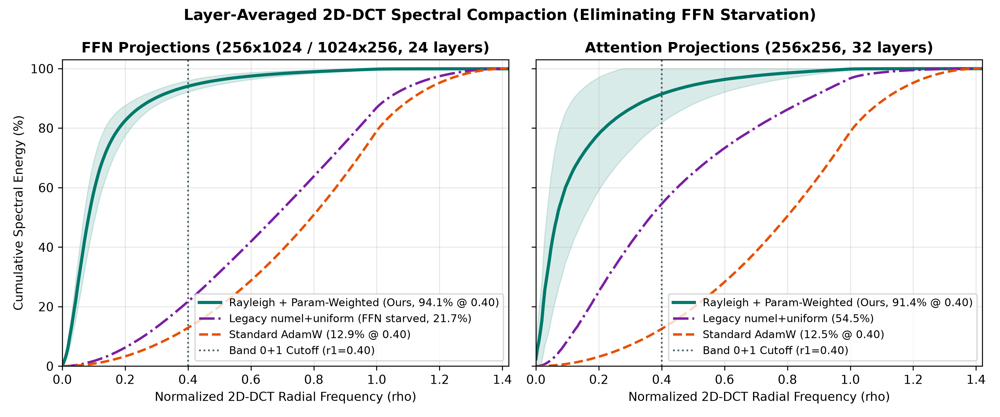
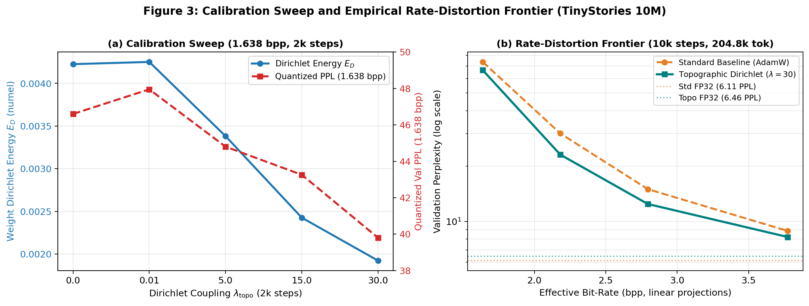

<div align="center">

# Dirichlet Regularization (`dreg`)
### Spatial Smoothness in Neural Weight Manifolds for 2D-DCT Spectral Compression

[](https://pypi.org/project/dirichlet-regularization/)
[](https://www.python.org/downloads/)
[](https://pytorch.org/)
[](https://github.com/mcarbonell/dirichlet-regularization/actions/workflows/ci.yml)
[](https://github.com/mcarbonell/dirichlet-regularization/tree/main/tests)
[](https://github.com/astral-sh/ruff)
[](https://github.com/mcarbonell/dirichlet-regularization/blob/main/paper/paper-draft.pdf)
[](https://github.com/mcarbonell/dirichlet-regularization/blob/main/LICENSE)

</div>

---

## The Core Idea

Standard neural networks treat weight matrices as unstructured, permutation-invariant point clouds. After training with isotropic $L_2$ weight decay, their 2D spatial frequency spectrum resembles **flat white noise** — only `~12.6%` of Frobenius energy lies below normalized frequency $\rho \le 0.40$, making frequency-domain compression ineffective.

**Dirichlet Regularization (`dreg`)** introduces a simple geometric inductive bias during training: *neighboring entries on a 2D weight lattice should vary smoothly*, analogous to topographic organization in biological cortex.

By combining **scale-invariant Riemannian Rayleigh normalization** ($\mathcal{R}(W) = \sum \Delta^2 / (2\|W\|_F^2)$) with **parameter-weighted layer aggregation**, `dreg` eliminates rectangular FFN gradient starvation and concentrates **91.6% (Attention) and 94.2% (FFN)** of total Frobenius energy below $\rho \le 0.40$ — enabling zero-overhead **MSE-clipped / Lloyd–Max Base-3 Trit Quantization (`.tritq`)** that beats both unregularized TritQ (**4.04× lower PPL at 1.638 bpp**, **11.4× lower PPL at sub-1-bit 0.914 bpp**) and Spatial Group-wise INT2 (`g=64`, **2.19× lower PPL using 27% fewer bits**).

<p align="center">
  
</p>

> **Figure 1: Emergent 2D Cortical Weight Manifolds in TinyStories-10M (10,000 steps, seed 42).** Representative Layer-3 weights (`mlp.gate_proj` top, `attn.q_proj` bottom). Left: Standard AdamW yields white-noise geometry (`12.9%` / `12.5%` energy $\le 0.40$). Right: Rayleigh + parameter-weighted Dirichlet annealing ($\lambda = 2.0 \to 0$) induces continuous cortical-like weight manifolds across **both** rectangular FFN and square Attention projections (`94.1%` / `91.4%` energy $\le 0.40$).

---

## The Mathematics

Standard $L_2$ weight decay penalizes magnitude and is strictly invariant to row/column permutations ($\|\pi(W)\sigma(W)\|_F^2 = \|W\|_F^2$). **Dirichlet Regularization** penalizes discrete 2D spatial differences on the unit lattice $\mathbb{Z}_M \times \mathbb{Z}_N$ via the separable Neumann graph Laplacians $L_M$ and $L_N$:

$$\mathcal{R}(W) = \frac{\sum_{i=1}^{M-1}\sum_{j=1}^N (W_{i+1,j}-W_{i,j})^2 + \sum_{i=1}^M\sum_{j=1}^{N-1} (W_{i,j+1}-W_{i,j})^2}{2\|W\|_F^2 + \epsilon} \in [0, 4]$$

Because the eigenvectors of the 1D Neumann Laplacian are exactly the orthonormal **Type-II DCT** basis vectors, $\mathcal{R}(W)$ diagonalizes cleanly in the 2D-DCT domain $S = D_M W D_N^\top$:

$$\mathcal{R}(W) = \frac{\sum_{k=0}^{M-1}\sum_{l=0}^{N-1} 4\!\left[\sin^2\!\left(\frac{\pi k}{2M}\right) + \sin^2\!\left(\frac{\pi l}{2N}\right)\right] S_{k,l}^2}{2\sum_{k,l} S_{k,l}^2}$$

Weighting each layer by its parameter share $\frac{M_l N_l}{\sum_j M_j N_j}$ yields exact shape symmetry between square Attention and $4\times$ wider FFN projections, while $\langle W, \nabla_W \mathcal{R}(W)\rangle = 0$ projects the diffusion gradient tangentially onto the Frobenius sphere (preventing norm collapse during from-scratch training). For adapting outlier-heavy pre-trained LLMs (e.g., GPT-2 124M), `normalization="rayleigh_sg"` detaches $\|W\|_F^2$ to yield pure Neumann diffusion ($-\Delta W / \|W\|_F^2$) with identically zero DC gradient.

<p align="center">
  
</p>

> **Figure 2: Layer-Averaged 2D-DCT Spectral Compaction (all 24 FFN & 32 Attention layers, TinyStories-10M, 10k steps).** Legacy `numel+uniform` (purple) starves FFNs at `21.7%` vs. `54.5%` Attention. Scale-invariant `rayleigh + param_weighted` (teal) eliminates FFN starvation completely (`94.1%` FFN / `91.4%` Attention vs. `12.9%` / `12.5%` Standard AdamW).

---

## Quick Start

### Installation

```bash
pip install dirichlet-regularization
```

Or from source:
```bash
git clone https://github.com/mcarbonell/dirichlet-regularization.git
cd dirichlet-regularization
pip install -e .
```

Optional extras:
```bash
pip install -e ".[examples]"    # torchvision + matplotlib for examples
pip install -e ".[dev]"         # pytest, pytest-cov, ruff
```

### Apply to Any PyTorch Model (3 lines of code)

```python
from dreg import DirichletLoss, StepCooldownScheduler

# Automatically skips nn.Embedding, lm_head, frozen weights, and deduplicates tied weights.
# For from-scratch training: normalization="rayleigh", weight_decay=1.0–2.0 + StepCooldownScheduler.
# For pre-trained LLM adaptation: normalization="rayleigh_sg" (scale lambda ~ N_total * sigma_W).
topo_reg = DirichletLoss(
    weight_decay=2.0,
    normalization="rayleigh",
    layer_weighting="param_weighted",
)
topo_sched = StepCooldownScheduler(topo_reg, total_steps=10_000, cooldown_ratio=0.15)

# Inside your training loop:
task_loss = criterion(model(inputs), targets)
topo_sched.step()
total_loss = task_loss + topo_reg(model)
total_loss.backward()
```

---

## Empirical Highlights

### 1. TinyStories-10M Multi-Seed (`N = 3`, 10,000 steps / 81.92M tokens, A10G)

Controlled multi-seed (`seeds = 42, 100, 2024`) evaluation on 25 validation batches (204,800 tokens; full logs in [results/tmlr_10000s_mseclip_multiseed_results.json](https://github.com/mcarbonell/dirichlet-regularization/blob/main/results/tmlr_10000s_mseclip_multiseed_results.json)):

| Condition (10k, `N=3`) | FP32 PPL | Attn / FFN $E_{\le 0.4}$ | `0.430 bpp` (74×) | **`0.914 bpp` (35×)** | **`1.638 bpp` (19.5×)** | **`2.181 bpp` (14.7×)** | `2.794 bpp` (11.5×) |
| :--- | :---: | :---: | :---: | :---: | :---: | :---: | :---: |
| Standard ($\lambda=0$) | **5.81 ± 0.01** | 12.6% / 12.9% | 3472.7 ± 950.0 | 1085.5 ± 214.1 | 68.21 ± 6.94 | 19.70 ± 0.70 | 9.79 ± 0.17 |
| Rayleigh ($\lambda=1.0$) | 7.39 ± 0.02 | 91.3% / 95.0% | 1914.7 ± 558.8 | 223.8 ± 134.7 | 23.74 ± 6.51 | 11.77 ± 1.87 | 8.68 ± 0.50 |
| Rayleigh ($\lambda=2.0$) | 8.19 ± 0.06 | **96.2% / 98.3%** | 1302.0 ± 395.5 | 120.6 ± 40.3 | 23.46 ± 5.71 | 12.48 ± 1.76 | 9.14 ± 0.03 |
| **Rayleigh Anneal ($2\to 0$)** | 7.78 ± 0.05 | 91.6% / 94.2% | **1131.4 ± 317.5** | **95.60 ± 28.26** | **16.87 ± 1.73** | **10.71 ± 0.64** | **8.56 ± 0.07** |

**SOTA PTQ Baselines on the exact same 10k `N=3` Standard models:**
* **Spatial Group-wise INT2 (`g=64`, `2.25 bpp`)**: `36.91 ± 6.03 PPL` — beaten **2.19×** by our `1.638 bpp` model (**27% fewer bits**) and **3.45×** by our `2.181 bpp` model (`10.71 ± 0.64 PPL`).
* **Spatial Uniform INT2 (`2.00 bpp`)**: `47.39 ± 7.90 PPL` (**2.81× worse** than our `1.638 bpp`).
* **Budget-Matched Quantized SVD (`INT8`, `~1.64 bpp`)**: `555.65 ± 65.74 PPL` (**32.9× worse**).
* **Zero-Bit-Overhead Quantizer Ablation (`1.638 bpp`, `rayleigh_anneal2`, `N=3`)**: `minmax + legacy` (`51.55 ± 3.90`) → `+ Lloyd–Max Band-2` (`31.62 ± 2.88`) → `+ MSE-Clip Band-0/1` (**`16.87 ± 1.73`**; verified on-disk `.tritq` round-trip `16.702 == 16.702`).

<p align="center">
  
</p>

> **Figure 3:** (a) 2k-step Rayleigh calibration sweep showing balanced Attn/FFN compaction (`12.7% → 97.8%`) and monotonic compression gains. (b) Converged 10k multi-seed (`N=3`) rate–distortion frontier vs. SOTA PTQ baselines.

### 2. Pre-Trained OpenAI GPT-2 (124M, 48 `Conv1D` matrices / 84.9M weights)

1,500-step `rayleigh_sg + param_weighted` adaptation (`lr=3e-4`, A10G, [results/gpt2_124m_rayleigh_sg_1500s_results.json](https://github.com/mcarbonell/dirichlet-regularization/blob/main/results/gpt2_124m_rayleigh_sg_1500s_results.json)):

| GPT-2 (124M) Variant | FP32 | Attn / FFN $E_{\le 0.4}$ | `1.63 bpp` | `2.18 bpp` | `2.79 bpp` | `3.77 bpp` | Spatial INT4 (`4.0b`) |
| :--- | :---: | :---: | :---: | :---: | :---: | :---: | :---: |
| Base Pre-Trained (0 steps) | 11.96 | 12.6% / 12.9% | 8355.36 | 5474.80 | 2638.98 | 1761.02 | 2440.52 |
| Standard Fine-Tuned ($\lambda=0$) | **4.65** | 12.6% / 12.9% | 4130.36 | 4050.95 | 2546.29 | 684.46 | 1449.10 |
| `rayleigh_sg` ($\lambda=25$) | 5.35 | 32.8% / 37.2% | 2052.39 | 638.34 | 152.76 | 31.96 | 963.10 |
| **`rayleigh_sg` Anneal ($200\to 0$)** | 12.93 | 71.2% / 76.8% | 281.84 | 117.55 | 43.20 | **21.62** | 997.09 |
| **`rayleigh_sg` ($\lambda=500$)** | 18.64 | **73.0% / 79.2%** | **178.71** | **60.35** | **33.07** | 23.37 | 1115.46 |

* Cuts weight roughness by **−95.6%** (`0.033514 → 0.001464`) and reduces compressed perplexity by **23×–77×** across `1.63–3.77 bpp` (beating Group INT2 `g=64` `3209.12 PPL` at `2.25 bpp` by **53.2×** at `2.18 bpp`).

### 3. Vision MLP on MNIST (`234.75K` parameters, 5 epochs)

| Metric | Standard MLP | Topographic MLP (`dreg`, $\lambda=15$) | Gain |
| :--- | :---: | :---: | :---: |
| FP32 Test Accuracy | **97.87%** | 97.58% | $-0.29\%$ (preserved) |
| Dirichlet Energy ($E_D$, `numel`) | 0.0219 | **0.0034** | **$-84.5\%$ roughness** |
| Low-Frequency Energy ($\rho \le 0.40$) | 27.87% | **52.84%** | **$1.90\times$ compaction** |
| Low-Pass Truncation Acc ($\rho \le 0.40$) | 30.69% | **41.41%** | **+10.72% abs.** |
| Base-3 TritQ Acc (`1.64 bpp`) | 87.40% | **88.59%** | **+1.19% accuracy** |

---

## Quantization Format (`.tritq`) & C11 Direct Spectral Micro-Kernel

* **Exact Base-3 Trit Packing + Zero-Overhead Optimal Quantization:** 5 balanced trits $\{-1, 0, +1\}$ pack bijectively into 1 byte ($3^5 = 243 \le 256 \Rightarrow 1.60\text{ bits/trit}$), paired with **1D Lloyd–Max Band-2 scaling** and **MSE-optimal asymmetric clipping on Bands 0 & 1** (`band01_mode="mse_clip"`), decoded in $\mathcal{O}(1)$ via a `1.25 KB` L1-cache LUT. Non-topographic parameters (`token_emb`, `lm_head`, LayerNorms) stay uncompressed in FP16.
* **Portable C11 Micro-Kernel (`kernel/spectral_dma_kernel.c`):**
  * **Zero-copy async DMA double-buffering** (Win32 Events / POSIX pthreads) verified to `3.6e-7` float32 parity against PyTorch.
  * **Direct Spectral-Domain Streaming MatVec (`c_spectral_matvec_direct`):** Computes $y = \operatorname{IDCT}_{1D}(S \cdot \operatorname{DCT}_{1D}(x))$ via radix-2 $\mathcal{O}(N \log N)$ Makhoul 1D-DCT directly from `.tritq` bitstreams **without materializing $M \times N$ weights or storing DCT basis tables** — cutting `1024×256` FFN working SRAM from `8,448 KB` down to **`13.0 KB`** (**`650×` reduction**) and running **`45.6×` faster** than full-matrix 2D-IDCT reconstruction (`8.9e-7` float32 parity).

---

## Reproducing Locally (CPU)

```bash
# 1. Run the master end-to-end verification suite (102 tests + C parity + trained MLP + controls)
python examples/reproduce_all.py

# 2. Build and benchmark the native C11 DMA & direct spectral micro-kernel
python kernel/build_kernel.py
python examples/benchmark_c_dma.py

# 3. Train a small Topographic Transformer or MNIST MLP locally
python examples/train_topographic.py
python examples/train_mlp_dirichlet.py --dataset mnist --epochs 5
python examples/evaluate_falsification.py
```

---

## Repository Structure

```text
dirichlet-regularization/
├── dreg/                            # Core Python package
│   ├── topology.py                  # 2D Dirichlet energy (numel/edges/rayleigh/rayleigh_sg), DirichletLoss & schedulers
│   ├── spectral.py                  # Orthonormal 1D/2D-DCT/IDCT (float64 angles), spectral_matvec & BlockDCTTiler
│   ├── quantization.py              # Base3TritQuantizer (mse_clip + lloyd_max) & .tritq binary checkpoint format
│   ├── model.py                     # Reference TopographicTransformer & TopographicLinear
│   └── baselines.py                 # Haar random orthogonal rotation & truncated SVD controls
├── kernel/                          # Native C11 zero-copy DMA & direct spectral matvec micro-kernel
│   ├── spectral_dma_kernel.c        # O(1) trit LUT, Win32/POSIX async DMA, radix-2 Makhoul 1D-DCT streaming matvec
│   ├── build_kernel.py              # Cross-platform compiler wrapper (gcc/clang/cl)
│   └── Makefile
├── examples/                        # Local CPU/GPU reproducible scripts
├── benchmarks/                      # Modal cloud A10G multi-seed training, GPT-2, SOTA PTQ & figure pipelines
├── results/                         # Raw JSON logs backing all paper Tables 1–6 and ablations
├── paper/                           # Academic manuscript (LaTeX source, BibTeX, 300-DPI figures, PDF)
│   ├── paper-draft.pdf
│   ├── paper-draft.tex
│   ├── references.bib
│   └── figures/
├── tests/                           # 102 automated unit, integration, and C-kernel tests
├── CITATION.cff
├── pyproject.toml
└── README.md
```

---

## Preprint & Citation

Read the full manuscript in [`paper/paper-draft.pdf`](https://github.com/mcarbonell/dirichlet-regularization/blob/main/paper/paper-draft.pdf):
> **"Inducing Spectral Smoothness in Neural Weight Manifolds via 2D Dirichlet Regularization"**  
> *Mario Raúl Carbonell Martínez (Independent Researcher)*

```bibtex
@misc{carbonell2026dirichlet,
  title={Inducing Spectral Smoothness in Neural Weight Manifolds via 2D Dirichlet Regularization},
  author={Carbonell Mart{\'i}nez, Mario Ra{\'u}l},
  year={2026},
  howpublished={\url{https://github.com/mcarbonell/dirichlet-regularization}}
}
```

---

## License

MIT License — see [`LICENSE`](https://github.com/mcarbonell/dirichlet-regularization/blob/main/LICENSE) for details.
